# mymcp-4-codexcloud

面向 **Codex Cloud 与云端 Dot** 的 MCP、skills 和插件集合，提供组织协作、Projects 任务记录、Lody 跨端操作及云环境准备能力。

本项目由 Dot 与公子沟通、协调项目负责人，并创建独立 Codex 云任务；执行端通过 Lody 协作和回传结果。这是本项目的职责约定，平台其他创建入口见[创建方式对照](docs/lody4dot/product-collaboration-reference.md#codex-cloud-与-work-cloud-的创建方式对照)。

## 从这里开始

| 要做什么 | 入口 |
| --- | --- |
| 明确岗位、汇报、任务分配与验收 | [组织协作 skill](skill/organization-collaboration/SKILL.md) · [接入说明](docs/organization-collaboration/README.md) |
| 查询或维护 GitHub Projects | [操作 skill](skill/github-projects-operations/SKILL.md) · [完整方案](docs/github-projects-operations/plan.md) · [CF-FE 接入记录](docs/organization-collaboration/github-projects.md) |
| 通过 Lody 发现资源、操作会话和跨端交接 | [Lody skill](skill/lody4dot/SKILL.md) · [文档索引](docs/lody4dot/README.md) |
| 使用工作区共享级／项目级专业角色 | [角色库](docs/lody4dot/workspace-roles/README.md) · [设计与边界](docs/lody4dot/workspace-roles/library-design.md) |
| 准备云环境、构建或分发插件 | [lody4dot 分发](plugin/lody4dot/README.md) · [新任务验收](docs/lody4dot/fresh-task-acceptance.md) |
| 查看已导入的 Gitee MCP | [源码与运行说明](mcp/gitee/README.md) |

## 当前状态

- **GitHub Projects 操作 skill：**当前源码候选为 **1.1.0**。此前 **1.0.0** 已取得执行器文件接入、实际读取、Linux 240 项测试及 Dot 指定对象只读调用回执；该证据不自动覆盖新版、原生自动发现或全员写权限。见[合并验证记录](docs/github-projects-operations/validation.md)。
- **组织与 Lody：**组织协议 **1.3.0**、lody4dot 组合候选 **0.7.0** 和两层专业角色库分别维护版本与接入状态。Projects 操作 skill 独立分发，未自动加入该组合包。
- **Gitee MCP：**已完成源码与资料导入；服务依赖安装、认证连接和实际运行未在本仓库验证。
- **正式任务管理：**正式看板是统一首查入口，全员在授权范围 list/read，写入按职责和对象收敛；每个项目的记录路由、任职、接入及切换分别确认。当前进度和下一步以[唯一任务队列](.codex/agent-state/todo.md#当前环境与下一步)为准。

## 协作与操作流程

项目负责人作业务决定和最终验收，当前记录写者登记并回读，流程审计者核对遗漏与整改；参与者优先查询正式看板及关联证据。图表示职责与调用路线，不表示已部署自动路由或已完成权限隔离。


[协作图源](docs/organization-collaboration/diagrams/traceability-and-audit.mmd) · [组织方案](docs/lody4dot/project-coordination.md) · [本轮验证与接入](docs/organization-collaboration/validation.md)

<details>
<summary>展开 Projects 最短操作流程与 UNKNOWN 对账</summary>



[操作图源](docs/github-projects-operations/diagrams/operation-flow.mmd) · [图表维护说明](docs/github-projects-operations/diagrams/README.md)

</details>

## 目录与开发

| 目录 | 职责 |
| --- | --- |
| [mcp/](mcp/README.md) | MCP 服务源码、依赖和运行说明 |
| [skill/](skill/README.md) | 技能唯一源码及完整随附资源 |
| [plugin/](plugin/README.md) | 组合、构建与分发定义 |

MCP 与 skill 提供能力，plugin 负责组合分发；生成物中的副本不单独维护。新增能力先读 [AGENTS.md](AGENTS.md)、目标目录说明及[架构与文档归档约定](docs/architecture.md)。

在仓库根执行，检查仅依赖 Python 3.10+ 标准库：

```bash
python3 scripts/check_repository.py
python3 -m unittest discover -s tests -v
```

本仓库没有需要统一启动的公共服务；各 MCP 按自己的说明运行。lody4dot 受管 runtime 仅支持 Linux，其他宿主的工具、安装和加载能力按[支持矩阵](docs/lody4dot/support-matrix.md)分别核验。

结构检查、文件可读、实际技能读取、MCP 调用和业务验收是不同证据层级。凭证使用目标环境的安全配置，不提交凭证、依赖缓存或构建包。

## 深入阅读

- [环境、会话与权限边界](docs/lody4dot/environment-model.md) · [多宿主方案](docs/lody4dot/collaboration-development.md) · [任务卡](docs/lody4dot/collaboration-tasks.md)
- [产品协作参考](docs/lody4dot/product-collaboration-reference.md) · [云端任务交接](docs/lody4dot/space-cloud-handoff.md)
- [Lody 历史验证与已知缺口](docs/lody4dot/validation.md) · [Projects 双端报告与技能验收](docs/github-projects-operations/validation.md)
