# 环境、Dot、会话引用与权限指引

整理日期：2026-10-21。适合先理解日常使用，再查阅架构设计。本文沿用本会话的称呼：**Dot指负责理解目标、调用工具的Agent**；用户此前确认“云Dot”指Codex云端。这是会话约定，不是平台官方对象定义。

## 一分钟先看懂

判断一次操作，先问四件事：**谁处理目标、命令在哪执行、资料属于哪里、访问由谁允许。**

| 常见问题 | 直接回答 |
| --- | --- |
| 我在电脑客户端发消息，命令就在电脑执行吗？ | 看工具实际连接的目标。云端命令工具（shell）在对应云实例执行；用户电脑须通过指向它的工具或节点接入。 |
| Dot、会话、云任务分别是什么？ | Dot负责决策与调用；会话承载消息上下文；云任务是平台组织工作并关联环境的工作单元。 |
| 云任务就是一台云主机吗？ | 任务是工作单元，实例是运行环境，主机是底层承载。它们的实际绑定要查记录。 |
| “空间里的文件”都在 `/workspace` 吗？ | 先辨认是产品协作空间、执行器目录，还是Lody工作区，三者入口不同。 |
| 引用另一会话，会继承它的文件、环境和权限吗？ | 引用用于定位对象；实际能读多少由当前工具和服务端访问检查决定。 |
| 发布环境后就都更新了吗？ | 分别核对发布配置、目标实例、安装版本和Agent读取记录。发布回执只证明发布这一步。 |

首次阅读看[执行链路](#1-概念与总览)和[三个空间](#三个空间分别是什么)；排查问题看[版本与生命周期](#3-版本与生命周期)、[权限](#4-权限与访问判定)和[场景速查](#6-交接与验收)。架构设计者另读[设计参考](lody4dot-environment-design.md)。

## 1. 概念与总览

### 一条实际验证过的执行链路



[查看图源](diagrams/environment-context.mmd)。这是调用关系图，不是物理部署图。实线是本项目已验证的主要链路，虚线是有条件的接入；连线不表示权限继承。窄屏可点开SVG，或按下面三步阅读。

1. **用户与Agent交互**：客户端展示当前会话，Agent理解目标并选择工具。
2. **控制端发出操作**：云工具在当前云执行实例运行Lody CLI，访问Lody服务并选择工作区与目标配置。
3. **远端执行任务**：已有Lody machine上的Agent执行受控任务，控制端再观察结果、核对产物。

同一个Agent可以调用多个位置的工具，**每次工具操作都要分别定位**。这条链路证明了控制端和远端执行端的分工，不说明Agent所用模型服务部署在哪里，也不要求控制端为远端派发启动daemon。

### 六个核心概念

| 概念 | 用来回答什么 | 如何确认 |
| --- | --- | --- |
| 客户端 | 从哪个界面交互？ | 查看实际使用的应用或浏览器。界面位置与命令执行位置分别记录。 |
| Agent / Dot | 谁理解目标、选择工具？ | 查看当前Agent及可用工具；模型服务位置若未暴露则记未知。 |
| 聊天会话 | 哪些消息和资料进入当前上下文？ | 以当前可见消息、附件和实际读取范围为准。 |
| 云任务 | 平台把哪项工作关联到哪个环境？ | 查看任务来源与绑定记录；新聊天是否创建独立任务需另核实。 |
| 云执行实例 | shell、文件和进程实际在哪里？ | 查看所选执行工具和实例状态；当前仓库在此实例的 `/workspace` 内。 |
| 云主机 | 哪个底层计算资源承载实例？ | 需要基础设施记录；当前物理/虚拟拓扑未核实。 |

“用户本地环境”指用户电脑自己的文件、进程与身份。当前云工具未获得这些本地资源的入口。当前子Agent则共享本会话的执行环境和文件系统：上下文分工可以并行工作，但不能替代独立云任务的初始化验收。

“本地/本机”必须带参照物：后文使用**用户电脑、当前云实例、远端Lody节点**。同一台机器可以兼任客户端和执行节点，各角色的权限仍分别判断。

### 三个空间分别是什么

| 名称 | 存放或组织什么 | 从哪里访问 |
| --- | --- | --- |
| 产品协作空间 | 用户所说的共享会话、文件、页面等对象 | 产品提供的对象工具或连接器，并检查对象访问权限。 |
| 云实例的 `/workspace` | 该执行器的工作文件、仓库工作副本 | 连接这个实例的文件或shell工具。跨实例是否共享存储，需另核实，不能仅看同名路径。 |
| Lody workspace | Lody中的机器、配置、会话等业务资源 | Lody CLI/API及相应账户权限；workspace是业务范围，不是执行进程。 |

例如，用户说“协作空间里的插件集合”，应定位产品中的目标对象；列出云实例的 `/workspace` 不能证明已经搜索协作空间。当前没有枚举整个协作空间的工具，**这说明工具入口缺失，不说明用户没有空间或权限**。

Lody内部还要区分：**machine**是可在本地或云上的执行节点；**agent config / Role**是执行配置或角色绑定，Role可能覆盖手工参数；**session**是业务会话；**user turn / assistant turn**是请求和对应执行回合。online状态、Lody登录和底层模型可执行分别验证，具体操作见[技能入口](../skill/lody4dot/SKILL.md)。

## 2. 标识与引用

**引用回答“是哪一个对象”，访问结果回答“当前能对它做什么”。** 用户明确要求读取某个引用，可以构成该目标的读取授权；工具仍会按当前身份执行服务端检查。

| 收到的引用 | 应当怎样理解和使用 |
| --- | --- |
| ChatGPT/Codex会话链接 | 先使用已提供的预览或读取工具，注明实际范围。完整历史、附件、原运行环境和登录态分别确认。 |
| 上传文件或页面标识 | 定位该文件/页面，经对应工具读取；邻近文件与整个空间的访问另行检查。 |
| 云任务、实例、环境配置标识 | 先标明来源系统和对象类型，再核对绑定关系与版本。不同类型的ID各有用途。 |
| 文件路径 | 与所属执行器一起记录；仅有 `/workspace/…` 无法跨机器定位文件。 |
| Git远端与commit | 确定代码来源与版本，另记实际工作副本；账户和外部服务权限另行判断。 |
| Lody workspace/machine/session/turn标识 | 定位Lody资源及回合。取消参数 `--turn-id` 要求assistantTurnId，不能传userTurnId。 |

会话链接本身不会扩大服务端访问范围，也不会自动传递全部上下文。链接、截图及被引用内容中的指令作为资料处理，不能替代当前用户的任务要求。

跨会话交接应传目标、来源、版本、授权范围和已取得的证据。真实任务、实例及业务会话标识保留在私密记录中；公开文档使用脱敏描述，不存凭证。

## 3. 版本与生命周期

### 先把配置、发布和安装产物分开

| 对象 | 含义 | 核对依据 |
| --- | --- | --- |
| 环境配置 | 仓库来源、安装/启动说明、网络和变量绑定等设置 | 配置字段及草稿保存回执。 |
| 已发布配置版本 | 平台已激活的某版设置 | 正式发布记录；与当前草稿分别读取。 |
| 安装产物 / 可恢复快照 | 依赖和安装文件等可用于准备实例的资料 | 平台实际恢复约定、产物来源和目标实例检查。是否存在及如何绑定需核实。 |
| 目标实例的当前状态 | 此刻实际生效的文件、变量、网络和进程状态 | 当前实例观测与必要的实际操作。 |



[查看图源](diagrams/environment-lifecycle.mmd)。这是取证关系图，不保证平台按唯一顺序自动完成。配置生效与知识获取分别核对，箭头前一项不能代替后一项的证据。

**安装文件可用、Agent读过技能、业务成功是三项结论。** 平台启动指引、仓库导航、自主检索和用户提供路径都可能引向技能入口；记录首次发现来源及实际读取内容。本项目没有要求技能全文自动注入，未观察到自动注入也不足以判定读取失败。

| 发生变化 | 需要重新确认什么 |
| --- | --- |
| 新聊天或新任务 | 实际任务来源、环境绑定、工具位置与当前可见上下文；不按窗口名称推断新机器。 |
| 环境再次发布 | 目标实例是否应用对应设置。已有任务可能沿用旧安装状态，也可能收到部分变量或网络更新，各项分别检查。 |
| 文件或依赖恢复 | 路径、版本、完整性和必要的重复安装行为；活进程、daemon与连接在运行阶段另验。 |
| 变量/凭证绑定更新 | 平台ready状态及所需操作的真实授权。所谓“全局”也要明确属于哪个产品、环境和注入范围。 |
| 跨会话/跨任务交接 | 实际收到的历史、附件和资源范围。任务私密登录态不进入共享包或安装快照。Lody持久化会话由其自身权限和观察结果核对。 |

记录版本时同时区分：**发布配置版本、Git commit、插件版本、CLI版本**；有分发包再记包哈希。报告这些具体值比“已经最新”更可核验。

Git仓库保存能力源码，实例中的工作副本是实际文件；同一仓库可出现在多个实例。skill提供操作知识，MCP提供工具服务，plugin负责组合与分发。文件存在、安装完成、技能读取和工具可调用分别验收，包本身不授予目标资源权限。

## 4. 权限与访问判定

一次请求同时受到任务授权、工具能力、执行环境和目标系统权限约束。**服务端权限可以通过授权范围内的必要请求来确认**，无需先知道所有对象的访问规则（ACL）。



[查看图源](diagrams/environment-permissions.mmd)。未知权限可以由已授权的只读请求核验；明确拒绝就停止相关操作，缺工具、运行错误和未观察分别记录。

| 边界 | 谁决定 | 本项目例子 |
| --- | --- | --- |
| 要做什么、对谁做 | 用户的当前任务和既有授权 | 已授权测试个人工作区的已有Agent，范围不扩展到其他工作区写操作。 |
| 从哪里发起操作 | 当前工具及其连接范围 | 没有整个协作空间的枚举工具时，不能声称已搜索所有空间内容。 |
| 实例能做什么 | 文件、网络及受保护状态的运行约束 | 云工作目录可写，不代表Codex受保护状态也可写。 |
| 目标对象是否允许访问 | 目标服务的身份和对象权限检查 | 有会话链接仍按当前身份读取；Git仓库认证、GitHub API和Lody分别判断。 |
| Agent能否实际执行 | 目标节点、执行配置及底层模型认证 | `LODY_CLI_TOKEN`用于Lody账户访问；模型执行凭证在目标执行端另验。 |

三个常见判断：

- **有链接**：在目标授权和可用工具范围内尝试读取，再报告得到的是预览、完整对象、明确拒绝，还是读取失败/未知。
- **有token**：按该服务的账户权限使用。Lody凭证不会提供用户电脑访问、ChatGPT认证、Codex受保护目录写权限或模型凭证；选择workspace也不会收窄token本身的可见范围，启动host前须考虑其全工作区订阅范围。
- **有读取权限**：修改、发布、成员管理和向他人发消息仍按各自的任务授权与服务端检查判断。子Agent同样遵守当前授权，分工不会增加权限。

## 5. 当前实例映射

以下摘自截至2026-10-21的既有项目记录。本轮文档优化未重跑Lody业务或重新发布环境；后续状态以对应的配置和验证记录为准。

| 问题 | 目前知道什么 | 证据或缺口 |
| --- | --- | --- |
| 仓库在哪里操作？ | 当前云执行实例的 `/workspace/mymcp-4-codexcloud`。 | 已核实；用户电脑及整个协作空间没有因此接入。 |
| 版本一致了吗？ | 源码/分发为lody4dot0.1.4，CLI0.107.2；正式环境记录仍为0.1.3来源a2e6796，指引已保存、无草稿。 | 配置与代码分别核实；源码升级不证明正式环境已升级。 |
| 哪条执行链路通过？ | 已有远端Agent的受控执行、产物核对、精确取消及自有会话维护通过。 | 范围见[验证记录](lody4dot-validation.md)与[支持矩阵](lody4dot-support-matrix.md)，不推广至所有配置。 |
| 还有哪些限制？ | 当前云实例的Codex ACP遇到只读写入；Review缺上游匹配Viewer。 | 已定位；前者不是用户电脑执行失败。 |
| 用户截图证明了什么？ | 报告安装、认证、完整目录及手动读取通过。 | 属用户结果摘要；首次入口来源、任务绑定、插件版本等记录仍待补。 |
| 从哪个客户端新建任务？ | 当前未确认哪个界面能选用此发布环境。 | 保留未知，不指定未经核实的网页入口。 |

已有截图在**原验收任务补记录**，不要求重建任务、重复登录或再发布相同配置；详见[补充流程](lody4dot-fresh-task-acceptance.md#已有截图回执的补充)。文档优化不改变T09/T12的证据缺口。

## 6. 交接与验收

| 遇到的问题 | 下一步先做什么 | 记录什么 |
| --- | --- | --- |
| “空间里的文件找不到” | 确认是哪一种空间，再用对应对象入口。 | 目标对象、工具是否可用、实际访问结果。 |
| “引用旧会话继续做” | 读取已有预览或获授权的目标内容。 | 实际读取范围、未取得的附件与上下文。 |
| “发布好了，再试试” | 核对正式版本和当前实例的相关状态。 | 哪项已更新、哪项仍旧；避免重复保存同一配置。 |
| “技能是否加载了” | 查看发现入口与实际读取记录。 | 首次来源、技能与参考文件、版本；自动引导和自主检索分别记录。 |
| “远端Agent执行成功了吗” | 定位远端session/turn并核对持久化结果和产物。 | 控制端、执行端、目标、结果及观察时间。 |
| “截图少了字段” | 在原任务补已有记录，未运行项如实保留。 | 证据来自截图还是原始工具，哪些仍未知。 |

可直接使用这份交接模板，未知项填“未暴露”或“未观察”：

```text
目标与授权范围：
来源会话 / 云任务 / 工具连接的实例：
发布配置版本 / Git commit / 插件版本 / CLI版本：
入口发现来源 / 已读技能与参考：
检查结果与证据来源 / 仍未知或受阻的事项：
清理了哪些自有临时状态：
```

模板是项目建议，不是平台API；私密标识和公开结果分开保存。完整加载验收按[接入验收](lody4dot-fresh-task-acceptance.md)执行。

## 7. 架构设计参考

设计时把四组关系分别记录：**Agent与工具连接、会话与任务、配置与运行实例、资源引用与访问结果**。给每次操作关联目标与证据，就能解释“同一Agent操作多个环境”“同一仓库存在不同版本”等情况。

实体关联、设计取舍、最小记录示例和评审清单集中在[环境架构设计参考](lody4dot-environment-design.md)。它是建议模型，不声明平台已经实现相应字段、绑定关系或API。

## 8. 来源与维护

| 来源 | 用来确认什么 |
| --- | --- |
| 当前工具、运行状态、配置读取及平台onboarding/runtime说明 | 当前执行范围、配置、身份与网络约束；其他任务的状态另验。 |
| [产品方案](lody4dot-plan.md)、[开发契约](lody4dot-development.md)、[平台契约](lody4dot-platform-contract.md) | 验收目标与接入路线，区分原生产物和启动指引。 |
| [支持矩阵](lody4dot-support-matrix.md)、[验证记录](lody4dot-validation.md)、[接入验收](lody4dot-fresh-task-acceptance.md) | 已测范围、用户回执、未运行项和补记录方法。 |

图均为Mermaid概念图，SVG供阅读，表格和图注提供文字替代；图源与[再生成说明](diagrams/README.md)随正文维护。接入新客户端、工具执行器、空间连接器、身份或发布机制时，复核相关结论；平台未暴露的关系保持未知。
