# 组织协作 Skill 与云端 Dot 协作方案

2026-10-28，实施规范 v0.4。v0.2于2026-10-26经公子接受并启动Goal实现：云端 Dot 是最上层负责人，沟通公子与各项目负责人；项目下所有大小需求和任务都经过审阅、规划、分配；开始任务先判断粒度与并行机会；Dot 可直接委派 Codex Cloud；所有参与端具备独立组织协作skill，按本次上下文确定责任及汇报关系，专业角色库另行维护。本版按公子要求整合通用就地复核、CF-FE任务记录及授权代录职责，保留上述组织边界。规范、分发与实际端侧生效分别验收，见[组织skill接入](../organization-collaboration/README.md)及[唯一队列](../../.codex/agent-state/todo.md#当前环境与下一步)；本页不宣称正式看板、任职绑定或远端技能已生效。

这是[多宿主协作方案](collaboration-development.md)的治理增量，当前只维护这一份组织设计。[GitHub记录适配](../organization-collaboration/github-projects.md)落实本组织的工具选择，通用skill保持平台中立。组织规则、当前关系、任务上下文和[专业角色库](workspace-roles/library-design.md)分别维护；正式入口的选择和迁移状态见[任务队列](../../.codex/agent-state/todo.md)。本文图表均为流程设计或示例，不填写实际业务状态。

## 本轮边界与实施选择

公子已接受“看板统一入口、三层记录、独立流程审计、原关联恢复”的方案并授权实现、测试与推送。架构路径为 **ARCHITECTURE_GATE，已由本轮明确方案批准满足实施条件**：新增组织岗位`auditor`的监督对象与报告路径，保留项目负责人验收、记录者登记及原生执行状态所有权。不引入新的任务数据库、常驻服务、自动派发器或全局锁。

正式看板是组织各角色理解当前工作的共同入口；任务合同、事件、执行状态、产物和验收按引用展开，各类信息仍有唯一来源。看板缺项、滞后或冲突时标记待核对，不能用聊天摘要直接改阶段，也不能拿旧字段抹掉真实执行。新独立派发及验收只在其依赖的关联与冲突核清后继续；未切换项目保持原入口。

新增`auditor`适用于明确委派的流程监督，一次性抽查仍可由合适的现有审查者承担。它核需求、派发、记录与验收是否可追溯，向绑定上级报告并把发现交负责人整改；不重做专业QA、不代签验收、不自行停机。独立性按被审决定、执行和登记片段判断；任何被审者不能独自关闭有争议的发现。定义存在不授予跨项目访问权、任命或调度权限。

三层记录、事件与派发恢复的唯一正文为[追溯指引](../../skill/organization-collaboration/references/task-traceability.md)，审计范围、覆盖与整改的唯一正文为[审计职责](../../skill/organization-collaboration/references/auditor.md)，避免在项目流程另抄一套规则。实际仓库路由及工具映射见[组织适配](../organization-collaboration/github-projects.md)。


[图源](../organization-collaboration/diagrams/traceability-and-audit.mmd)。以下已有职责与图示继续说明分工；图中的委托查询是可选路线，不是所有参与者必须中转。具体采用版本、在途切换点及复核证据见[接入说明](../organization-collaboration/cloud-acceptance.md)。

## 0. 独立组织协作 Skill

采用独立的[organization-collaboration技能](../../skill/organization-collaboration/SKILL.md)，由云端Dot、项目负责人、执行者及审查端共同具备。它负责识别组织岗位、责任链、接单规划、汇报、交接和异常升级。专业角色库继续提供研究、视觉、编码、审查等能力定义与领域要求。一个执行端可以在不同项目使用同一专业能力，但每次执行都绑定明确的项目任务和汇报关系；换专业角色不自动改变组织职位或权限。

本组织的顶层负责人绑定为公子确认的云端Dot；通用协议按组织岗位描述责任，具体参与者及通信入口由当前关系记录提供，不把这一绑定推广为其他用户或所有Lody环境的默认。



[可编辑Mermaid图源](diagrams/organization-context.mmd)。实线表示本次上下文的来源及使用关系；虚线表示按任务需要选用专业能力。图不表示自动注入或已实现的服务。

| 内容 | 保存什么 | 权威位置与维护者 |
| --- | --- | --- |
| 组织协作skill | 稳定协议、组织岗位工作法、汇报格式、节点放行与接管规则 | 唯一源码`skill/organization-collaboration/`，与`skill/lody4dot/`及专业角色库独立；不内置真实人员、机器、会话或项目进度 |
| 当前组织与项目关系 | 云端Dot、项目负责人、可用回报通道、项目正式入口及关系版本 | 复用现有私密工作区／项目正式记录。有效任命方确认负责人或接管；Dot按已获任命权限组织该过程。负责人核定项目事实，总索引只定位入口，不复制项目进度 |
| 本次任务上下文 | 当前参与者、项目与任务、业务负责人、汇报对象、实际派发者、验收者、输入版本与授权范围 | 从有效任务指派和当前正式记录取得。任务包只带本次相关切片及来源，不广播完整组织名单 |
| 专业角色与技能 | 如何完成领域工作及专业验收 | 现有角色库与专业skill；按需引用，不能替代组织任命、任务授权或实际工具权限 |

skill的最小形态是短`SKILL.md`加总协调、项目负责人、执行／审查、上下文与汇报模板等按需参考。每端加载共同核心和本次组织岗位的必要内容，不把全部岗位流程、组织名单和角色库塞入常驻上下文。首版采用可读任务包和现有正式记录，不先引入组织数据库、自动路由器、守护进程或专属通信服务。

### 安装与生效

“每端安装”是分发目标；生效还需要该任务实际读到协议及自己的关系绑定。首次接单、切换项目或发生接管时，通过该宿主已支持的启动指引或任务提示，定位组织skill并提供本次上下文。普通跟进复用有效绑定和准确任务引用，只有范围、关系或版本变化时补读；不在每个回合重扫组织、重验全包或强制汇报一遍身份。

每个参与端应能明确回答：我是谁、属于哪个项目和任务、对谁负责、把结果交给谁、通过哪个实际入口汇报、谁派发或续发、谁验收、哪里是正式状态、哪些动作在授权范围内。不能从角色名、创建者或机器名猜答案。缺失或冲突只暂停依赖该关系的派发、写入或外发，已有明确授权且不依赖缺口的工作继续；向任务发起方或已确认上游索取精确缺项，不自行认领负责人。

下例仅是可读任务包，不是Lody/Codex原生API字段，也不把示例当有效身份：

```text
当前参与者：执行端 A；本次组织岗位：执行者
项目／任务：P / T12；组织关系来源：P正式入口的 r2
总负责人：云端 Dot；本项目负责人及业务责任人：O
我向谁汇报：O；实际回报通道：经 Dot 中转至 O
实际派发／续发协调者：Dot；集成与最终验收责任人：O
原生执行关联：已有 Cloud 任务引用 C（没有实际回执时不填造）
输入与依赖：合同 v3；T11已达到约定标准
工作范围／输出：模块 A；提交及检查证据；授权与预算沿任务原记录
正式状态入口：P当前采用的唯一入口；专业能力：按需另选，不决定上述关系
```

同一任务的业务责任、平台派发和验收可以由不同主体承担，任务包必须分别表达。通信通道用于送达，汇报关系用于确定接收和责任；通道暂不可用不改变负责对象，也不自动授权换通道外发。任务包只能引用既有有效权限，不能凭字段扩大操作范围。

### 汇报与维护

执行者和QA向项目负责人报告本任务与产物版本、实际状态及证据、阻塞或待决定项、下一步和责任人；负责人向Dot报告项目成果、依赖变化及需升级事项；Dot向公子汇总交付与决策请求。Dot自身协调任务由Dot接收和验收。直接技术交流可在已有授权内进行，责任和正式状态仍回到指定负责人，避免把所有讨论变成层层转发。

在受理、关键产物、阻塞、范围／版本变化、交接和完成时更新必要记录；小任务可合并到一次结果回报。默认不增加定时心跳或无变化消息。收到ACK、保存成功、任务完成、独立检查通过、最终交付分别记录，不用一个“完成”覆盖所有证据。断连或发送UNKNOWN先对账原调用，不自动重复发消息。

现有角色共同合同、G8和项目owner正文包含部分组织规则。本次将通用组织职责迁入新skill的唯一正文，旧可编辑入口保留短指引；领域验收及凡人生产限制留在专业／项目适配中。历史V2.2保持原样。迁移先核依赖与包内可读性，不能先删除现有边界，也不长期维护两份相同规则。

`lody4dot`保留Lody命令、配置、身份及平台操作指导，组织skill须能独立分发和使用，也可与现有插件组合，不能让全员接入依赖Lody CLI、Lody setup或完整角色库。没有已验证的原生安装入口时，分别记录受支持的资料读取方式和实际加载状态，不把可读文件冒称安装完成。历史0.4.0首次在组合包收集该skill并提供独立分发；当前版本与方法见[接入说明](../organization-collaboration/README.md)。manifest的`skills: ./skills`仍不能单独证明所有端已经加载；每次实际构建和分端回执分别核对。

## 1. 责任层级与委派路线


[可编辑 Mermaid 图源](diagrams/project-governance.mmd)。双向线表示任务和回执的沟通路线，连线表示决定、查询／登记请求及回执，记录系统访问经授权记录职责承担。图中的记录职责可由已有参与者承担，既不表示共享凭证，也不赋予额外权限。

| 角色 | 负责的决定与成果 | 职责边界 |
| --- | --- | --- |
| 云端 Dot（承担现有 G8 总协调职责） | 与公子沟通；确定需求归属、跨项目优先级与资源协调；沟通各项目负责人；创建获授权的 Codex Cloud 任务并关联回执；汇总交付 | 项目需求交给项目负责人治理；项目任务已有派发记录时不重复直派。Dot 汇总引用，不另维护一份竞争的项目事实表 |
| 每个项目唯一负责人 | 审阅全部项目需求、缺陷与可交付子任务；规划粒度与依赖；分配职责和写入范围；核定正式状态；判断节点是否可开始；组织复核、集成、最终验收和关闭 | 可委托分析、执行和记录操作，保留业务决策及最终验收责任；接受取舍不能改写客观失败，也不能替代独立 QA 或公子的新授权 |
| 执行者 | 按任务包和当前输入版本完成工作、自检，提交产物、原生回执与未决事项；获委派时承担记录职责 | 在已分配范围内自主推进；正常事实进度按预授权记录；新范围、冲突和业务决定回交负责人，不把工具写权限当验收权 |
| 独立 QA／专业审定者 | 按适用验收要求检查明确版本的成果，返回报告；修订后核对受影响结论 | 检查者未参与该精确版本制作或修订，并实际核查证据才具有独立性；复用合适的现有会话，作者换名或新开会话本身不能证明独立 |
| 流程审计者 `auditor` | 对照获准的需求、派发／执行、任务与验收来源，报告漏项和冲突并复核整改 | 只在声明范围内出结论；报告Dot并交项目负责人整改；不替质量审查、业务验收、记录写者或原生控制者 |

本表的总负责人、项目负责人、执行、质量审查与流程审计是组织岗位，不等同于专业角色库条目，也不要求每个岗位都有常驻进程或新会话。项目负责人可以自领小任务；涉及独立 QA 时仍需满足独立性。云端 Dot 与项目负责人各有明确层级，不再增加并列的总协调入口。

按成果归属确定责任：凡修改项目资产、影响项目交付或消耗项目生产许可的工作，进入该项目负责人流程。负责人缺位或需接管时，有效任命方确认人选；Dot仅在已获相应任命权限时确认临时负责人，并交接原任务、在途状态及写入责任。正式身份或任命依据未确认时保留待确认，其他参与者不得自动补位签发最终项目验收；已授权且不依赖该身份的工作继续。负责人暂不可达不允许隐式抢占旧写者。

v0.3.1形成时，本组织云端Dot没有GitHub Projects直接连接，采用图中的授权记录者委托路线。2026-10-27后续已取得ChatGPT Work／Lody两端回执，公子明确全员按范围直接list/read；当前接入事实见[组织适配](../organization-collaboration/github-projects.md#最新接入与职责方向)，写入收敛及独立操作skill见[新方案](../github-projects-operations/plan.md)。图中的委托读取保留为可选路线，不再表示所有读取都必须中转；实际写者和项目验收责任仍分别确认。

### 授权记录职责

授权记录者是`executor`可承担的一项任务职责，不是独立组织岗位，也不是新的专业角色。项目负责人可亲自记录，或委派具备条件的参与者代录；总负责人自身协调任务沿已绑定的业务责任执行。机器是执行位置，GitHub账号和凭证决定可调用范围，岗位与任务授权决定本次应做什么，三者分别核对。

代录时在既有任务包中明确目标条目、允许更新的字段或内容、决定／证据来源及回读责任。正常事实进度、阻塞和证据引用按已给定规则更新，不逐笔等负责人批准；范围、分工、依赖放行、最终验收等决定由相应责任人作出，记录者按明确决定写入并标明来源。记录者核写入结果，不替负责人签发验收；缺明确决定时可记录已知事实和待确认项，不能补造通过。

记录者按[唯一职责正文](../../skill/organization-collaboration/references/authorized-recording.md)做记录前的一致性审查：创建查相关在办与未知请求，更新核当前阶段及版本，关闭核有效验收／取消决定和残余工作承接。冲突保留提报与当前值，只暂停相关覆盖并交相应责任方核实；相似标题不能自动判重复，正常事实无冲突时按预授权登记。该审查不替代专业QA或形成逐笔业务审批。

写入边界按条目及获授权字段划定，同一范围避免竞争写入；不同条目可由不同记录者并行维护，不设置全组织记录锁。接管记录工作时交清未决写入、对象引用及最后回读，未知结果先对账，不以新建同目标条目替代查询。项目已有负责人独写约束时继续遵守，明确调整该项目的委派范围后才代录；通用能力不自动覆盖项目限制。

**项目任务走 Codex Cloud：** 项目负责人完成审阅、规划与分配，先由本人或授权记录者创建／关联项目当前正式任务。已切换到GitHub时须有准确Issue及Project条目引用，再向Dot交清任务包；Dot核已登记关联、依赖和已有执行后创建一次，将真实Cloud引用存入同一任务获准的受控记录，公开Issue只保留可公开引用／摘要，沿原关联回传状态与产物。负责人组织检查并更新本项目进度；Dot 再向公子汇总。项目负责人负责业务验收，Dot 承担此路线的创建与回传；两端复用同一个项目任务关联，不能各自另开一份同目标任务。

**Dot 自身的协调任务：** 跨项目分析、汇总等由 Dot 在自身职责和有效授权内审阅、规划、分配，可直接委派 Codex Cloud，由 Dot 验收；同样先关联组织正式任务，不能绕过登记。其结果若形成某项目的新实施需求，再交该项目负责人；不为总协调任务虚构项目，也不借此绕过项目治理。

**已有 Lody 执行路线：** 负责人按当前授权和实际工具指派明确的执行者及派发者。直接 Codex Cloud 路线不必经过 Lody；同一任务不能为提高成功率同时走两条写入路线。当前项目的独立 Codex Cloud 创建仍由 Dot 承担，云任务不再派生 Codex Cloud 任务。工作区专属配置沿用[执行规范](workspace-roles/execution-policy.md)。

## 2. 全部纳管，按风险与粒度处理


[可编辑 Mermaid 图源](diagrams/project-task-flow.mmd)。需求审阅关注范围、优先级、依赖和验收；成果审查关注实际产物，两者分别发生。

所有需求、缺陷和可交付任务都经过负责人审阅、规划与分配。任务从公子、Dot、执行者或 QA 哪个入口到达，都必须归属一个负责项目或 Dot 自身的协调工作。执行者发现的新需求先回交负责人；已批准父任务内的工具调用、读取和实现步骤沿用原规划，不逐条新建任务或重复申请有效授权。

| 情形 | 负责人怎样处理 |
| --- | --- |
| 小而明确、低风险、单一成果 | 在同一回合完成范围审阅、一步计划、指定自己或已有执行者、核结果；在原任务留下简短归属和处置记录，不新开一套流程 |
| 多步骤、多人、多轮次或需恢复 | 拆成可独立验收的成果，明确依赖与开始条件，写入现有项目进度表；交接成本高于收益的部分保持串行 |
| 高风险、关键输入或授权不清 | 先安排必要的确认、设计或专业审定节点；仅阻断依赖该缺口的工作。风险与大小分开，一条发布或删除命令也可能需要严格核对 |

开始任务或范围、依赖、输入版本实质变化时判断一次：能否独立验收、依赖是否稳定、写入是否冲突、资源是否足够、交接和集成是否值得。结论可以是直接完成、先串行定约后并行，或立即并行。接收明确任务包的执行者复用已有判断，不递归重复拆分，也不为展示规划创建多余会话。

负责人集中处理入口、关键节点、变化与最终验收；执行者在任务包内自主推进。已有授权内的常规分配不逐次上报 Dot 或请公子确认。跨项目冲突、超预算、缺失的新授权或业务取舍由负责人报 Dot，确需公子决定的再由 Dot 汇总询问。

## 3. 进度表与依赖节点


[可编辑 Mermaid 图源](diagrams/project-parallel-gates.mmd)。这是软件任务的依赖示例；时间预估用于安排，实际开始由条件是否满足决定。凡人项目既有“生产阶段默认串行，仅并行无依赖核验、视觉或只读检查”的限制继续适用，不由此示例扩大生产并行范围。

项目负责人对现有唯一正式入口的进度和决定负责，记录操作可按上述范围委派。共同目标、授权范围、资源上限和总体验收写一次；每项成果只引用必要任务包，不复制整份上下文。任务阶段使用易读标签，原生状态及观察时间单独保留，`UNKNOWN`不转成完成或重新派发。

| ID／成果 | 责任人／写入范围 | 前置版本与开始条件 | 计划阶段／原生状态、观察时间 | 原生任务、产物与验收证据 | 下一步／责任人 |
| --- | --- | --- | --- | --- | --- |
| T1 接口约定 | 负责人；接口文档 | 需求范围已明确 | 示例：规划中；未派发 | 无实际回执 | 确定版本与验收／负责人 |
| T2 模块 A | 执行者 A；模块 A | T1 的约定版本已接受，资源与写入范围可用 | 示例：等待前置；未派发 | 无实际回执 | 满足条件后分配／负责人 |
| T3 模块 B | 执行者 B；模块 B | 同 T2，且与 A 可独立实现与验收 | 示例：等待前置；未派发 | 无实际回执 | 可与 T2 同时开始／负责人 |
| T4 集成产物 | 唯一集成者；集成分支 | T2、T3 产物版本和自检证据齐备、基准相容 | 示例：等待前置；未派发 | 无实际回执 | 集成并自检／集成者 |
| T5 验收结论 | 独立 QA；报告 | T4 明确版本可检查，满足独立性与检查条件 | 示例：等待前置；未派发 | 无实际回执 | QA 后由负责人核交付并关闭 |

每次准备开启节点，负责人核对：**前置成果达到约定标准且版本确定、当前授权覆盖、工具与资源可用、唯一写者和派发者明确、验收标准可执行。** 多个节点同时满足且互不冲突，才开启并行。只完成依赖箭头、到达日期或角色空闲，不足以放行。

在分配、受理、阻塞、产物版本变化、检查完成、交接和关闭时更新必要记录。Dot 查看项目摘要、阻塞及证据引用；事实进度按预授权记录，依赖业务决定的状态转换依据负责人的明确结论。子任务自报完成、ACK或完成数量不能直接换算整体通过，整体还需集成及约定交付验收。

上游输入变化时标记受影响的下游结论失效，重核该分支的依赖和版本；未受影响的成果继续复用。旧结果未知时按原任务对账，不能重新创建来代替查询。需要停止或取消正在执行的任务时，另按现有授权及原生协议处理，不把图中的“等待”当成进程已经停止。

### 本组织的 GitHub 记录分工

全局总览使用CF-FE组织Projects。Issue优先放入项目已指定的GitHub仓库；没有指定时使用环境仓库`CF-FE/mymcp-4-codexcloud`。这是一份组织适配，不能写成其他用户通用skill的默认。

| 信息 | 当前事实的维护位置 |
| --- | --- |
| 任务目标、范围、成员分工与验收条件 | Issue正文及其引用的有效任务上下文 |
| 当前工作阶段、优先级和下一责任方 | 选定Project的对应字段；具体字段映射只在适配指引维护 |
| 可独立交付的子任务、前置关系 | 子Issue与依赖；普通实现步骤保留在原任务清单 |
| 执行与检查证据 | Issue关键节点记录及必要的受控证据引用；原生运行状态和日志仍归原系统 |
| 最终验收 | 项目负责人绑定精确产物的回执；记录者据此更新，不由闭Issue、合PR或子项百分比自动推出 |

产物默认在所在端复核，制作自检、质量复核和负责人验收分列；报告先交负责人，Dot收结论与阻塞，不要求先上传原文件或再审批一次。逐项通过、不通过、未验与技术运行状态分开，必验未验、身份待确认或阻断缺陷都不能最终通过。缺工具、文件或访问时补检查条件；有已证实不符合时才提出针对产物的修订要求。

Cloud派发前的Issue／Project关联、创建成功后的原生引用回填及失败边界见[派发前关联](../organization-collaboration/github-projects.md#codex-cloud-派发前关联)。一个业务任务可关联必要的多个执行或续跑，不按每个实现步骤建单；记录回填失败不重建Cloud，直接委派不免登记。

采用GitHub前先明确正式Project及负责人、仓库路由、字段和可见性，再为在办项建立旧任务引用到Issue的映射并记录切换点。切换后旧进度表只保留历史或链接，不继续双写当前阶段；未切换的项目继续使用原正式入口。已关闭的旧Project不能自动当作当前主看板，工具验收通过也不代表任务迁移完成；实际选择和迁移状态只在[唯一队列](../../.codex/agent-state/todo.md#当前环境与下一步)记录。

默认环境仓库是公开仓库；私有Project不会改变Issue可见性。公开记录仅含可公开的任务摘要和证据引用，完整私密绑定及产物留在有访问控制的项目记录。具体权限、记录更新、故障对账和最小验收流程见[GitHub记录适配](../organization-collaboration/github-projects.md)，本页不复制工具参数或维护另一套状态。

## 4. 本轮辩证后的取舍

| 原主张的价值 | 主要反例 | 方案修订 |
| --- | --- | --- |
| 所有任务经负责人，减少遗漏 | Dot 与负责人同时直派同目标；小任务层层往返 | 统一归属与业务验收；一个实际派发者；小任务在同一回合完成审阅、规划、分配 |
| 到节点后并行，提高资源利用 | 文件不重叠却依赖未定接口；小改动令旧输入版本失效 | 按依赖、版本、资源与写入条件放行；变化后只重核受影响分支 |
| 进度表方便跟进与恢复 | Dot、专家与负责人维护三份冲突状态；百分比掩盖未验收 | 负责人维护唯一项目事实，其他层汇总引用；状态关联回合、产物和证据 |
| 专门负责人保证质量 | 负责人写完再自称独立 QA；规划权被当生产许可 | 治理审阅、专业审定、执行和独立 QA 的责任分开；有效授权仍按具体动作判断 |
| 所有端安装同一协作skill | 已安装但当前会话未加载，或未取得负责人信息 | 分别验证可取得、实际读取、关系绑定与正确行动；首次接单和关系变化时补齐 |
| 人人知道自己的汇报关系 | 真实负责人写死在技能；跨项目或接管后沿用旧关系 | 稳定协议与有来源、版本的组织绑定分开；每个任务明确责任、派发、验收和实际通信通道 |
| 独立组织skill便于复用 | 与角色共同合同、Lody协作参考各复制一套规则 | 组织规则唯一维护，专业与平台内容分别保留；先验证迁移再收短旧入口 |
| 由有工具权限的端集中记录 | 把Mac等机器当岗位；记录者替owner决定完成；每条事实都等批准 | 记录职责由既有executor承担，按条目／字段预授权；事实直接记录，业务决定和最终验收保留明确来源 |
| 记录前审查避免错单 | 把相似标题当重复、迟到报告覆盖新版、关单掩盖在途执行；或每次重审整个项目 | 按动作定向查重和核对版本／决定，冲突只阻断相关覆盖；记录者负责一致性，不决定业务取舍 |
| CF-FE总看板统一跟进 | Issue、Project和旧Markdown各维护当前阶段；私有看板被误当公开Issue的保密层 | 字段各有唯一来源，显式切换后停止旧状态双写；按Issue自身可见性选择记录内容和仓库 |
| 严格验收保证质量 | 缺接口被写成音频缺陷，所有失败分支都要求作者返工 | 未验走条件补齐和阻塞解除；已证实不符合走精确修订；两者都需重新核证才能通过 |

这组修订与现有[并行规范](../../skill/lody4dot/references/collaboration.md#并行在办任务)、[G8职责](../../skill/lody4dot/references/roles/workspace/coordinator.md)、[项目负责人职责](../../skill/lody4dot/references/roles/projects/fanren-owner.md)一致，补的是入口覆盖、分级处理与节点条件。项目专属生产限制保留，不复制进通用角色默认。

## 5. 固化、验证与迭代

本文维护流程含义；四份`.mmd`维护图源，`.svg`为生成展示，修改时一起核对，重绘方法见[图表维护](diagrams/README.md)。任务执行状态只写项目原有入口，图中不硬编码真实任务、机器、配置ID或历史进度。本次实现独立组织skill及最小上下文模板，收敛重复组织规则、扩展分发并分端验证；组织skill版本、关系记录版本和专业角色库版本分别维护。V2.2历史源不改写，远端Role保存与运行验证单独验收。

建议首轮以一个项目、Dot／负责人／执行端三个上下文做无业务副作用的走查：微小修改、独立分支大任务、执行中新缺陷；再加入旧回合UNKNOWN、输入版本变化和负责人接管。各端独立确认自身责任、报告对象、正式入口及唯一派发者，检查是否无重复创建、抢写和旧版本放行。再检查实际分发和新会话读取，最后用获授权的真实任务验证回报与验收。协议可读、模拟选择正确、实际加载和业务成功分别取证；再根据真实等待、交接、返工和总耗时判断并行收益。

当前未验证所有入口能自动回流、节点条件能被系统自动触发、角色绑定能持续监督，亦未测并行的真实收益。该流程由角色按实际可用工具执行，不提供分布式锁、服务端幂等或恰好一次派发保证。组织规则通过skill实施，实际参与者和通信绑定由当前任务提供；源码、安装与真实业务结果分开验收。

v0.1本地验证：独立对抗与优化意见已整合；图审查发现的“完成QA直接通向关闭”已补验收判断及失败分流。原三份Mermaid经解析、SVG渲染和中文排版检查，相关本地链接、仓库结构与diff检查通过；当轮222项测试中221通过、1项Linux锁测试在macOS跳过。v0.2另做独立对抗与优化，补充组织协议、动态责任关系及第四张图；该设计轮尚未实施新skill，不能沿用当时的代码回归宣称新增行为已通过。后续Goal的实现、走查与安装证据另记[验证记录](validation.md)。

v0.3在同一方案中对齐实际任命条件、授权代录和GitHub记录归属，并将未验与已证实不符合分开画入流程。组织协议、专业库、组织关系和工具凭证各自维护版本与生效证据；更新规范不自动覆盖旧任务、部署配置或已保存Role。本轮实现、图源／生成图核对及分端验收仍由[验证记录](validation.md)和唯一队列记账。

本次v0.3.1修正总负责人直接访问的隐含假设，按公子明确的Dot无Projects授权边界补齐委托查询回执；保留v0.3已有职责和派发前关联要求，委托查询可先于正式看板迁移验证。
