# 云端 Dot 与项目负责人协作方案

2026-10-26，评审候选 v0.1。公子已确认：云端 Dot 是最上层负责人，沟通公子与各项目负责人；项目下所有大小需求和任务都应经过审阅、规划、分配；任务开始先判断粒度与并行机会，大项目用进度表管理启动节点；Dot 可直接委派 Codex Cloud。本页将这些原则整理为可维护的流程，具体分流与节点规则是本轮辩证优化建议，尚未作为运行系统或已保存角色生效。

这是[多宿主协作方案](collaboration-development.md)的治理增量。角色定义仍在[现有角色库](workspace-roles/library-design.md)，实际进度沿用项目唯一正式入口；本仓库为[任务队列](../../.codex/agent-state/todo.md)。本文的图表均为流程设计或示例，不填写实际业务状态。

## 1. 责任层级与委派路线

[可编辑 Mermaid 图源](diagrams/project-governance.mmd)。双向线表示任务和回执的沟通路线，既不表示共享存储，也不赋予额外权限。

| 角色 | 负责的决定与成果 | 职责边界 |
| --- | --- | --- |
| 云端 Dot（承担现有 G8 总协调职责） | 与公子沟通；确定需求归属、跨项目优先级与资源协调；沟通各项目负责人；创建获授权的 Codex Cloud 任务并关联回执；汇总交付 | 项目需求交给项目负责人治理；项目任务已有派发记录时不重复直派。Dot 汇总引用，不另维护一份竞争的项目事实表 |
| 每个项目唯一负责人 | 审阅全部项目需求、缺陷与可交付子任务；规划粒度与依赖；分配职责和写入范围；维护唯一进度表；判断节点是否可开始；组织集成、验收和关闭 | 可以委托分析与执行，保留最终责任；接受取舍不能改写客观失败，也不能替代独立 QA 或公子的新授权 |
| 执行者 | 按任务包和当前输入版本完成工作、自检，提交产物、原生回执与未决事项 | 在已分配范围内自主完成实现步骤；新需求或越界发现回交负责人；不抢写正式项目状态 |
| 独立 QA／专业审定者 | 按适用验收要求检查明确版本的成果，返回报告；修订后核对受影响结论 | 未参与该对象制作或修订的上下文才算独立；作者可自检，不能换角色名自签独立 QA |

角色是责任划分，不要求每个角色都有常驻进程或新会话。项目负责人可以自领小任务；涉及独立 QA 时仍需满足独立性。云端 Dot 与项目负责人各有明确层级，不再增加并列的总协调入口。

按成果归属确定责任：凡修改项目资产、影响项目交付或消耗项目生产许可的工作，进入该项目负责人流程。负责人缺位或需接管时，由 Dot 明确指定临时负责人，交接原任务、在途状态及写入责任后再继续；不因负责人暂不可达而隐式绕过治理或抢占旧写者。

**项目任务走 Codex Cloud：** 项目负责人完成审阅、规划与分配，向 Dot 交清任务包；Dot 核对已有派发关联后创建一次，保存真实 Cloud 任务引用，将状态和产物回传负责人。负责人组织检查并更新本项目进度；Dot 再向公子汇总。项目负责人负责业务验收，Dot 承担此路线的创建与回传；两端复用同一个项目任务关联，不能各自另开一份同目标任务。

**Dot 自身的协调任务：** 跨项目分析、汇总等由 Dot 在自身职责和有效授权内审阅、规划、分配，可直接委派 Codex Cloud，由 Dot 验收。其结果若形成某项目的新实施需求，再交该项目负责人；不为总协调任务虚构项目，也不借此绕过项目治理。

**已有 Lody 执行路线：** 负责人按当前授权和实际工具指派明确的执行者及派发者。直接 Codex Cloud 路线不必经过 Lody；同一任务不能为提高成功率同时走两条写入路线。当前项目的独立 Codex Cloud 创建仍由 Dot 承担，云任务不再派生 Codex Cloud 任务。工作区专属配置沿用[执行规范](workspace-roles/execution-policy.md)。

## 2. 全部纳管，按风险与粒度处理

[可编辑 Mermaid 图源](diagrams/project-task-flow.mmd)。需求审阅关注范围、优先级、依赖和验收；成果审查关注实际产物，两者分别发生。

所有需求、缺陷和可交付任务都经过负责人审阅、规划与分配。任务从公子、Dot、执行者或 QA 哪个入口到达，都必须归属一个负责项目或 Dot 自身的协调工作。执行者发现的新需求先回交负责人；已批准父任务内的工具调用、读取和实现步骤沿用原规划，不逐条新建任务或重复申请有效授权。

| 情形 | 负责人怎样处理 |
| --- | --- |
| 小而明确、低风险、单一成果 | 在同一回合完成范围审阅、一步计划、指定自己或已有执行者、核结果；在原任务留下简短归属和处置记录，不新开一套流程 |
| 多步骤、多人、多轮次或需恢复 | 拆成可独立验收的成果，明确依赖与开始条件，写入现有项目进度表；交接成本高于收益的部分保持串行 |
| 高风险、关键输入或授权不清 | 先安排必要的确认、设计或专业审定节点；仅阻断依赖该缺口的工作。风险与大小分开，一条发布或删除命令也可能需要严格核对 |

开始任务或范围、依赖、输入版本实质变化时判断一次：能否独立验收、依赖是否稳定、写入是否冲突、资源是否足够、交接和集成是否值得。结论可以是直接完成、先串行定约后并行，或立即并行。接收明确任务包的执行者复用已有判断，不递归重复拆分，也不为展示规划创建多余会话。

负责人集中处理入口、关键节点、变化与最终验收；执行者在任务包内自主推进。已有授权内的常规分配不逐次上报 Dot 或请公子确认。跨项目冲突、超预算、缺失的新授权或业务取舍由负责人报 Dot，确需公子决定的再由 Dot 汇总询问。

## 3. 进度表与依赖节点

[可编辑 Mermaid 图源](diagrams/project-parallel-gates.mmd)。这是软件任务的依赖示例；时间预估用于安排，实际开始由条件是否满足决定。凡人项目既有“生产阶段默认串行，仅并行无依赖核验、视觉或只读检查”的限制继续适用，不由此示例扩大生产并行范围。

项目负责人在现有唯一正式入口维护进度表。共同目标、授权范围、资源上限和总体验收放在表头；每行只引用必要任务包，不复制整份上下文。任务阶段使用易读标签，原生状态及观察时间单独保留，`UNKNOWN`不转成完成或重新派发。

| ID／成果 | 责任人／写入范围 | 前置版本与开始条件 | 计划阶段／原生状态、观察时间 | 原生任务、产物与验收证据 | 下一步／责任人 |
| --- | --- | --- | --- | --- | --- |
| T1 接口约定 | 负责人；接口文档 | 需求范围已明确 | 示例：规划中；未派发 | 无实际回执 | 确定版本与验收／负责人 |
| T2 模块 A | 执行者 A；模块 A | T1 的约定版本已接受，资源与写入范围可用 | 示例：等待前置；未派发 | 无实际回执 | 满足条件后分配／负责人 |
| T3 模块 B | 执行者 B；模块 B | 同 T2，且与 A 可独立实现与验收 | 示例：等待前置；未派发 | 无实际回执 | 可与 T2 同时开始／负责人 |
| T4 集成产物 | 唯一集成者；集成分支 | T2、T3 产物版本和自检证据齐备、基准相容 | 示例：等待前置；未派发 | 无实际回执 | 集成并自检／集成者 |
| T5 验收结论 | 独立 QA；报告 | T4 明确版本可检查，满足独立性与检查条件 | 示例：等待前置；未派发 | 无实际回执 | QA 后由负责人核交付并关闭 |

每次准备开启节点，负责人核对：**前置成果达到约定标准且版本确定、当前授权覆盖、工具与资源可用、唯一写者和派发者明确、验收标准可执行。** 多个节点同时满足且互不冲突，才开启并行。只完成依赖箭头、到达日期或角色空闲，不足以放行。

在分配、受理、阻塞、产物版本变化、检查完成、交接和关闭时更新必要记录。Dot 查看项目摘要、阻塞及证据引用；项目正式状态由负责人核证后更新。子任务自报完成、ACK或完成数量不能直接换算整体通过，整体还需集成及约定交付验收。

上游输入变化时标记受影响的下游结论失效，重核该分支的依赖和版本；未受影响的成果继续复用。旧结果未知时按原任务对账，不能重新创建来代替查询。需要停止或取消正在执行的任务时，另按现有授权及原生协议处理，不把图中的“等待”当成进程已经停止。

## 4. 本轮辩证后的取舍

| 原主张的价值 | 主要反例 | 方案修订 |
| --- | --- | --- |
| 所有任务经负责人，减少遗漏 | Dot 与负责人同时直派同目标；小任务层层往返 | 统一归属与业务验收；一个实际派发者；小任务在同一回合完成审阅、规划、分配 |
| 到节点后并行，提高资源利用 | 文件不重叠却依赖未定接口；小改动令旧输入版本失效 | 按依赖、版本、资源与写入条件放行；变化后只重核受影响分支 |
| 进度表方便跟进与恢复 | Dot、专家与负责人维护三份冲突状态；百分比掩盖未验收 | 负责人维护唯一项目事实，其他层汇总引用；状态关联回合、产物和证据 |
| 专门负责人保证质量 | 负责人写完再自称独立 QA；规划权被当生产许可 | 治理审阅、专业审定、执行和独立 QA 的责任分开；有效授权仍按具体动作判断 |

这组修订与现有[并行规范](../../skill/lody4dot/references/collaboration.md#并行在办任务)、[G8职责](../../skill/lody4dot/references/roles/workspace/coordinator.md)、[项目负责人职责](../../skill/lody4dot/references/roles/projects/fanren-owner.md)一致，补的是入口覆盖、分级处理与节点条件。项目专属生产限制保留，不复制进通用角色默认。

## 5. 固化、验证与迭代

本文维护流程含义；三份`.mmd`维护图源，`.svg`为生成展示，修改时一起核对，重绘方法见[图表维护](diagrams/README.md)。任务执行状态只写项目原有入口，图中不硬编码真实任务、机器、配置ID或历史进度。后续若采用本候选，再将短入口与角色责任同步到skill及可编辑派生库，并更新库版本；V2.2历史源不改写，远端Role保存与运行验证单独验收。

建议先用三个无业务副作用的模拟请求走查：一个微小修改、一个含独立分支的大任务、一个执行中出现的新缺陷；加入输入版本变化与旧回合UNKNOWN。检验全部需求是否在执行前有审阅/计划/分配归属、依赖是否正确放行、是否保留独立QA、是否无重复派发，以及Dot代建Cloud后结果是否回到正确负责人。先验证流程覆盖与正确性，再根据真实等待、交接、返工和总耗时决定是否调整粒度。

当前未验证所有入口能自动回流、节点条件能被系统自动触发、角色绑定能持续监督，亦未测并行的真实收益。该流程由角色按实际可用工具执行，不提供分布式锁、服务端幂等或恰好一次派发保证。本轮仅形成文档和图源，不创建业务任务、不更新远端角色或自动化。

本轮本地验证：独立对抗与优化意见已整合；图审查发现的“完成QA直接通向关闭”已补验收判断及失败分流。三份Mermaid经解析、SVG渲染和中文排版检查，相关本地链接、仓库结构与diff检查通过；既有222项测试中221通过、1项Linux锁测试在macOS跳过。该验证覆盖文档与现有代码回归，不替代上面的流程走查或真实协作验收。
