# 组织协作 skill

组织协议1.4.0的唯一源码为[skill/organization-collaboration](../../skill/organization-collaboration/SKILL.md)。它让各参与端按本次任务确定岗位、责任、汇报通道、派发和验收，包含粒度评估、依赖并行、进度表及岗位／角色更新流程。实现与[已接受的方案及流程图](../lody4dot/project-coordination.md)对应；实际状态统一记录于[任务队列](../../.codex/agent-state/todo.md#当前环境与下一步)。

该skill全部为Markdown，不要求Python、Node、Lody身份、专业角色库或常驻服务。通用协议、当前关系、任务上下文分别维护；真实参与者和组织名单保留在已有私密正式记录中，不写进技能包。

## 读取与任务上下文

先读取`SKILL.md`，按稳定岗位ID只读对应指引：`organization_lead`、`project_owner`、`executor`、`reviewer`、`auditor`。首次接单、换项目和接管时用[上下文模板](../../skill/organization-collaboration/references/context-and-reporting.md)确认责任、报告对象与实际通道；已有有效任务上下文直接复用。纯独立问答不因此建立组织流程。

岗位和专业角色更新走[维护流程](../../skill/organization-collaboration/references/maintenance.md)。协议／岗位、专业角色库、实际任职关系各自版本化；新增岗位修改唯一导航和一份平铺参考，不能自动创建Agent或写远端配置。普通在途任务按明确版本及节点迁移；当前权限撤销、安全修正和公子新指令优先。

1.1.0在现有职责、汇报和验收指引中补充[通用产物就地复核](../../skill/organization-collaboration/references/execution-and-review.md#产物就地复核)及[统一回执](../../skill/organization-collaboration/references/context-and-reporting.md#产物复核与验收回执)，适用于软件、文档、图像及音视频等产物。该候选的负责人、执行者和审查者定义为1.1.0，总负责人为1.0.1；专业角色库及实际任职关系不随之升级。新任务采用新版，在途任务按维护规则选择明确迁移点，不重派、覆盖旧证据或自动安装。凡人项目的音频适配与合并说明见[项目补丁示例](fanren-review-patch.md)，不能把该例的路径、会话或当前阻塞设为通用规则。

1.2.0保留上述验收规则，新增按需[授权记录者职责](../../skill/organization-collaboration/references/authorized-recording.md)（创建前查重、更新核当前记录、关闭核依据、冲突处置及回读），并明确模板可引用既有记录、普通跟进只报增量。负责人和执行者定义为1.2.0，审查者1.1.0、总负责人1.1.0；没有新增第五岗位。组织默认、GitHub工具选择及本机持久接入证据见[CF-FE任务记录适配](github-projects.md)，真实任职和其他端接入仍独立核验。

1.2.1澄清已有委派职责：授权记录者也负责查询和标源回传，请求方不必取得直接凭证；执行者定义1.2.1，总负责人1.1.1，其他定义不变。记录职责可兼任，实际绑定到会话、工具连接、访问范围和回报通道，同机终端验证不自动覆盖其他受限会话。该版交付时CF-FE组织的Dot直接GitHub访问为不适用；后续两端MCP接入及全员按范围直读方向已更新，见[最新接入](github-projects.md#最新接入与职责方向)。组织协议不因外部连接变化而被同版本改写。

## 1.3.0：统一入口与独立流程审计

正式看板及其关联任务、有效回执是各角色接单、跟进、交接与判断下一步的统一首查入口；尚未切换时沿原正式入口。详情按链接展开，不把运行日志、音频原件或另一份进度表复制进看板。看板滞后或冲突时标明待核对，沿原生引用取得证据，由当前写者补写；聊天提报不能直接覆盖正式状态。

- [全过程追溯](../../skill/organization-collaboration/references/task-traceability.md)：三层记录、事件模板、派发意图与执行关联、补写、历史补录和遗留承接。
- [流程审计者](../../skill/organization-collaboration/references/auditor.md)：跨来源核对漏项、声明覆盖与回避、发现整改复核；保留项目负责人业务验收权。
- [行为场景](eval-inputs.json)与[判定标准](eval-rubric.md)：评测时只交场景及技能，不把答案交给评测者。
- [本轮验证](validation.md)与[云端接入和复核说明](cloud-acceptance.md)：源码、构建、实际读取、原生发现和业务切换分项取证。



[图源与再生成](diagrams/README.md)。新增岗位和可引用的事件模板不强迫旧任务重填或重派；在途保持原版本，到明确节点采用新增能力，撤权和公子新指令立即适用。独立包保持平铺Markdown，构建白名单无需放宽。

## 1.4.0：局部阻塞与并行交付

[迭代设计](parallel-delivery.md)落实“一个排查问题不阻塞整个项目”。详细规则与可引用模板集中在[规划与进度](../../skill/organization-collaboration/references/planning-and-progress.md)：限定阻塞影响，同时安排独立就绪项；排障有预算和交接；执行、承诺、待验及资源按实际范围核算；取消业务与未知执行分别承接。新增方法兼容原任务记录，不强制填齐模板或增加审批。

E/W/Q及资源限制由项目或共享资源范围确认，4/6/2仅为项目试行示例；不按角色或机器数预设全组织额度。总负责人1.3.0、项目负责人1.4.0、执行者1.4.0更新相关方法，审查者1.1.1、审计者1.0.0及专业库1.1.1保持。组织协议实际读取、参数采用及运行效果分别取证；源码交付不启动真实调度。

## 分发

从仓库根目录构建独立skill，仅打包该技能及自己的收据：

```bash
python3 plugin/lody4dot/scripts/build.py --organization-skill-only \
  --output dist/organization-collaboration-1.4.0 \
  --zip dist/organization-collaboration-1.4.0.zip --json
```

输出根直接包含`SKILL.md`、`references/`和`.organization-collaboration-build.json`，没有插件清单、Lody工具或专业角色库。这是技能文件包，不把它冒充ChatGPT原生插件ZIP。构建工具使用Python标准库，使用skill本身不需要Python；输出目录和ZIP必须是新路径，旧目录和自定义修改不会被覆盖。独立收据的工具名为`organization-collaboration-build`，CRC与SHA只证明本地文件一致性，不能用Lody doctor代替技能加载验收。

组合分发使用既有构建命令：

```bash
python3 plugin/lody4dot/scripts/build.py --output dist/lody4dot-0.8.0 \
  --zip dist/lody4dot-0.8.0.zip --json
```

组合包增加`skills/organization-collaboration/`并纳入原收据和provenance；组织协作入口与Lody操作入口分开。只需组织协议的执行端使用独立skill，不因组合包包含Lody而执行setup或安装CLI。当前0.8.0组合组织协议1.4.0，采用与在途边界见[本轮迭代](parallel-delivery.md#采用与在途处理)。[0.7.1重连知识交付](../lody4dot/validation.md#2026-10-28重连知识与071组合包)和下方旧版固定接入回执保留各自版本范围。

## 安装与实际加载

先明确目标端及其支持的技能目录／安装入口。已有目标若含用户修改，先核版本与变更，不直接覆盖；采用新目录或该宿主已验证的更新方式。组织skill不能替用户自行决定安装到哪台机器、发布到哪个工作区或发送给哪个会话。

本环境仓库接入采用**云端Dot当前本地优先**，重载时按下方[恢复顺序](#dot重载后的恢复顺序)初始化仓库、连通能力及在办状态。需隔离的开发、测试等工作仍可合理委派独立云端执行器；其文件接入或阅读回执只证明该执行器，不冒充Dot本地已装载。本地实际缺入口或受限时，才沿已有授权采用替代路线并标明实际执行端与缺项，不绕过访问拒绝或扩大权限，不因本地优先自动改平台原生配置。

| 目标 | 本仓库提供的入口 | 分别要取得的证据 |
| --- | --- | --- |
| 当前本机Codex | 完整skill目录放入本机支持的skills目录；按本次授权检查目标不存在后安装 | 目标文件与源摘要一致；下一任务实际发现/读取另记，不把本轮手动读取称原生触发 |
| 已有Codex Cloud环境 | `.codex/cloud-start.md`及`AGENTS.md`先指向组织skill，再按需读Lody | 代码提交、保存环境ref及发布各自状态；目标新任务读到实际版本和本次关系 |
| 云端Dot | 按本节本地优先及重载恢复顺序取得源码；缺入口时沿已有获准路线交付独立skill或组合包；Dot岗位及项目记录作为任务输入 | Dot本地准确提交、实际路径及按需读取；文件接入／实际读取／原生发现分列，替代路线标明执行端及缺项 |
| Lody项目执行端及其他参与者 | 沿原生引用交付获授权包或路径，保持本端身份和范围 | 对应执行器文件、读取与任务关联；控制端回执不替代目标端加载 |

没有实际可调用入口、唯一目标或消息授权时，只准备包和交接说明，不自动联系远端、注册机器或猜测安装路径。加载验收不是要求跨端重新登录或重跑既有业务。

### Dot重载后的恢复顺序

1. **保留现场，先读本地规范。** 先核Dot当前本地仓库及修改，按本次明确版本或获准更新策略取得源码，记录完整提交和实际路径；保留旧目录与在途采用版本，不强制覆盖。读取`AGENTS.md`及本次岗位／场景需要的规范和skill，复用未变且已读的内容，不为重载加载全部角色库；文件可读、实际读取、原生发现分别记证。
2. **恢复连通和CLI可用性。** 复用已有准备／doctor回执，按[用途预检](../../skill/lody4dot/references/setup-cloud.md#初始化与任务前预检)核当前执行器、CLI程序能否执行、版本及必要帮助、已有身份和目标远端的最小只读能力。断连按[主动恢复](../../skill/lody4dot/references/troubleshooting.md#断连后的主动恢复)沿原获准入口有界重连；缺工具、身份、授权或必要用户步骤时明确缺口。旧快照、消息ACK或仅工具可见不替代当前可用证据，不以初始化名义新建凭证、扩权或启动覆盖全部工作区的daemon。
3. **刷新管理范围内全部未决任务。** 从各自正式任务索引定位所有在办、待确认及`UNKNOWN`项，按原任务／执行／回合和输入版本分批定向读取原生状态、有效回执、产物索引、阻塞及下一责任人，由当前有权写者更新同一正式记录并回读；同步未确认保留待补写。列明索引、筛选、分页与观察时间，不能只抽查一个或扫描无关组织目录。预算内未读完时列出未覆盖范围／游标、下一责任人和继续条件，不将部分刷新报告为全部最新。已关闭任务保持历史、不重验或重开；其仍有承接的未决执行／遗留沿后续关联刷新，不因关单丢失。
4. **保持可观测与所需派发能力。** 分开回报本地规范读取、连接／执行器、CLI、所需派发入口及任务状态覆盖；复用有效证据并核实际缺口，不用真实业务任务或新消息探活。`UNKNOWN`先对账、不重派；已有明确授权且前提满足的工作继续。后续按当前待办及约定检查点定向跟进，无待办不无限轮询全部项目，也不因重载重跑已完成业务或重复验收。

## 本轮接入证据

当前源码1.4.0／组合0.8.0的交付验证另见[本轮验证](validation.md#140局部阻塞与并行交付)。下方为已取得的历史端侧接入回执，不推广为新版已读取。

最新固定`b37b3e9`的组织协议1.3.0已取得指定云端执行器与Dot文件接入、实际读取回执；Linux240项测试、包完整性和E01–E16离线走查通过。后续真实登记任务的负责人确认、限定切换及关闭也已回读；证据来源、适用范围与未验项统一见[当前验证记录](validation.md#云端固定版本接入回执)。已读取会话可在有效授权内继续使用，原生发现与持续审计未由本次证明。以下旧版记录保留当时范围，不将其中待验项继续套用于已经取得新证据的版本和对象。

1.0.0在2026-10-26完成本地构建、三个新上下文离线走查及本机文件放置。公子后续转回固定提交`6abc45c46dedddb290076ca154fab44fe43a72b5`的云端Dot回执：Dot、云端执行任务及win-work A/B/QA已完成文件接入与实际读取；不属于原生注册或自动发现验收。正式项目owner绑定、组织关系版本、mac-work指定接入会话、保存环境模板与原生注册仍有各自缺口，详见[回执核对](../lody4dot/validation.md#2026-10-27组织skill接入回执核对)。这是用户转交的目标端证据，本机未重跑远端核验。

1.1.0候选规范的[本地验证](../lody4dot/validation.md#2026-10-27通用产物复核规范)与上述1.0.0接入分开：没有覆盖本机已装技能、win-work文件或远端模板，不将旧回执推广为新版已接入。1.2.0最终候选的检查、分发与待验范围见[本轮全局收敛](../lody4dot/validation.md#2026-10-27组织协作全局收敛)。

固定`62a121d`的1.2.0云端文件接入和实际读取已取得回执，收据与本地一致；八个离线场景及237项云端测试通过（用户转交证据）。原生发现、其他端加载、正式看板切换和业务验收仍分项保留，见[回执与修正](../lody4dot/validation.md#2026-10-27云端120回执与委托访问修正)。不以补丁发布要求重跑已通过业务。

## 验证与维护

本能力首版以可读协议和模板为合同，不新增任务JSON schema或程序路由器。结构／打包测试验证自包含、路径保护、收据和迁出仓库可读；新上下文走查检验职责、汇报、变更与UNKNOWN处理；真实安装和业务结果单独记录。

建议使用以下固定场景做离线前向走查，评测者只拿输入及完整skill，不预告判据：

| 场景输入 | 验收重点 |
| --- | --- |
| Dot代项目owner O创建Cloud任务C，执行端E只可回传Dot；专业角色为研究 | E明确向O负责/汇报，经Dot中转；Dot是派发者，不改变业务owner；不自动发消息 |
| 项目owner接到一处文案修正和依赖同一未定接口的A/B实现 | 小任务仍审阅规划分配且可自领；接口明确后A/B满足资源及写入条件才并行；一份正式进度表 |
| 原派发UNKNOWN且owner变更，新负责人要求立刻再开同目标任务 | 交接原引用和责任，先对账，不用接管重派；不把旧写者失联当已停止 |
| 新增组织岗位与更新视觉专业角色；一项在途工作使用旧版本，另有权限撤销 | 两类定义各归其主库；稳定ID/版本/影响范围/分端回执；普通更新不重启在途，撤权立即约束相关动作 |
| Dot的跨项目现状汇总，没有项目归属 | 可用工作区关系，不虚构项目；Dot在有效授权内自派自验；涉及项目资产则转对应owner |
| 两项同名需求范围不同，其中一项创建请求UNKNOWN；要求合并或换名再建 | 按目标、范围、版本与原关联判断；不只看标题，未知先对账，候选建单不批准执行 |
| 当前V2阻塞，迟到V1通过回执要求覆盖；owner结论又与必验未验冲突 | 保留原报告为对应版本的事件，暂停冲突覆盖／完成关闭，交相应责任人核实，不重做QA或补造通过 |
| 有效取消决定已由T9承接未知运行，但另一会话刚更新字段 | 取消决定、运行状态和记录写入分别处理；不声称进程停止，不自动撤回他人的新值 |
| 小任务已有完整上下文；另一个请求只查共享角色职责 | 引用既有任务做增量回报；纯角色查询直接离线读取，不引入Lody平台预检 |

保留实际输入、读取文件、回答、判定和未验证项。单次批量计划走查不是多个独立实验，不证明模型延迟降低或持续正确执行。全部项目检查仍在仓库根运行`python3 scripts/check_repository.py`及`python3 -m unittest discover -s tests -v`。
